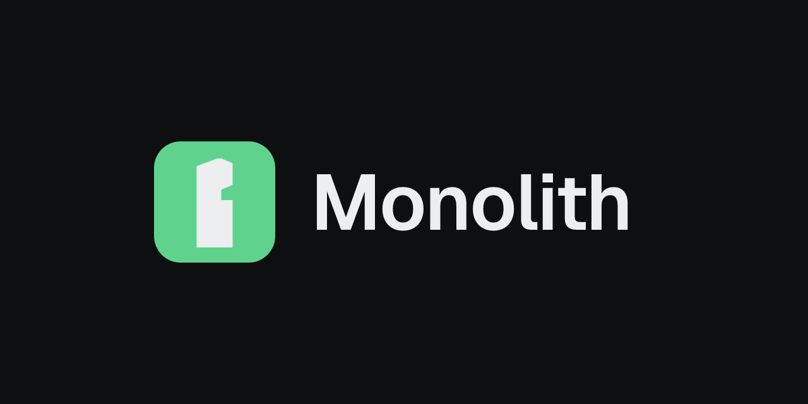
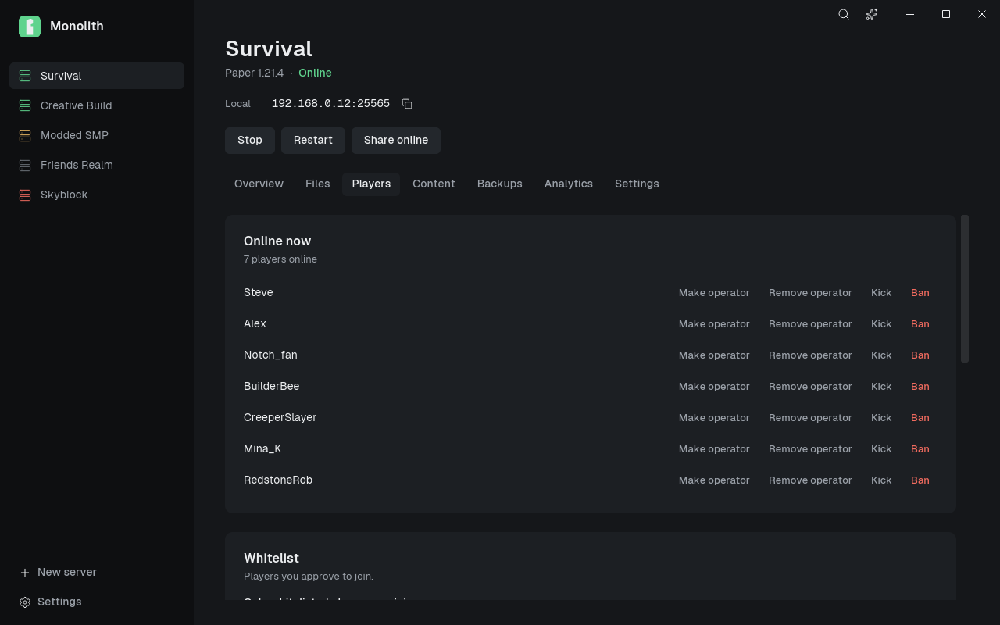
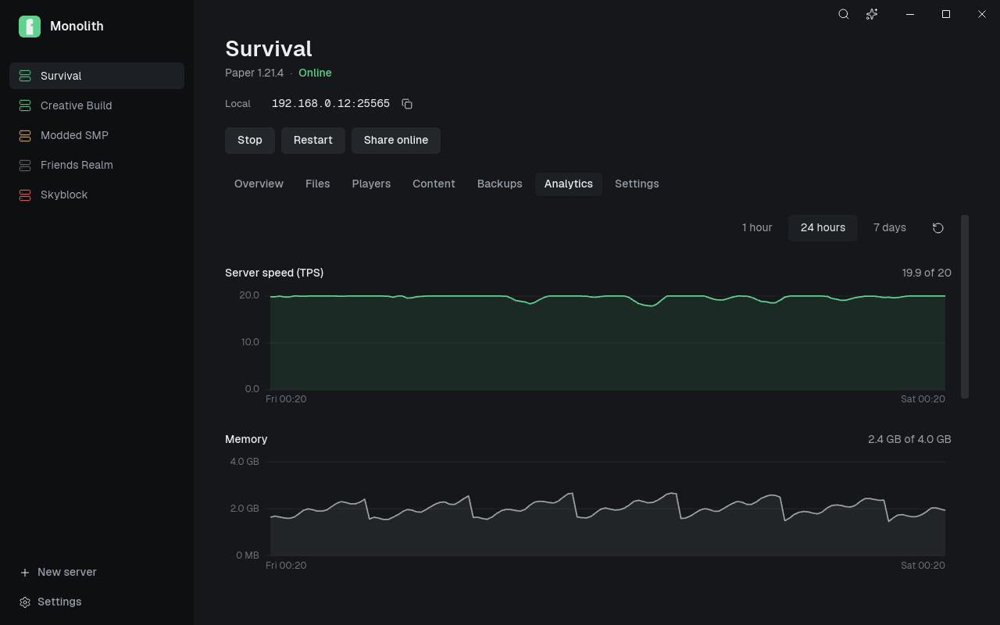

Monolith is a Minecraft server manager for Windows. It sets up, runs, shares and backs up your servers from one small native app, so you never have to touch a config file unless you want to.


## Features

- **Create a server in about a minute.** Pick Paper, Purpur, Fabric, Quilt, Forge, NeoForge or Vanilla and a Minecraft version (snapshots and pre-releases included). Monolith downloads the server (running the loader installer for Forge, NeoForge and Quilt) and the right Java runtime for you.
- **Play with friends.** Copy the join address for your local network, or turn on sharing to get a public address through ngrok.
- **Live console.** Colour-coded output right on the Overview, with players, TPS, memory and uptime above it, command history, and a view that stays put while you scroll.
- **Players.** Kick, ban or make someone an operator straight from the list of who's online.
- **Plugins and mods.** Search, install and update from Modrinth. Default plugin groups (for example "Performance" or "Skript") let you choose what goes on every new server.
- **Settings without config files.** Common `server.properties` options as plain controls, plus a raw editor, whitelist, ban list and file browser.
- **Backups.** One-click backups, scheduled backups and safe restores.
- **Stays up.** Automatic restart after a crash, scheduled daily restarts with in-game warnings, and port conflict detection with a one-click fix.
- **Analytics.** The bundled Monolith Analytics plugin charts TPS, memory and players over time on Paper and Purpur servers.
- **Keyboard first.** `Ctrl+K` opens a command palette for servers, actions and settings.
- **Optional AI assistant.** Bring your own OpenAI-compatible key. It can suggest changes, but nothing runs until you confirm the exact command or edit.

<p>
  
  
</p>

## Getting started

1. Download `Monolith-Setup-<version>.exe` from [Releases](https://github.com/waykehatescoding/monolith/releases) and run it. It installs for your user only and doesn't need admin rights.
2. Open Monolith and choose **Create your first server**.
3. Press **Start**. The first start asks you to accept the Minecraft EULA once and downloads anything missing.
4. Copy the join address from the server's page and send it to your friends. Friends on the same network can use it directly; for everyone else, press **Share** and copy the public address.

Already have a server folder or an export zip? Use **Import a server** instead.

## Requirements

- Windows 10 or 11, 64-bit.
- Enough free memory for your servers (Monolith suggests a sensible default).
- Java is downloaded automatically when a server needs it.

## Where your data lives

Servers, backups and settings are stored in `%APPDATA%\Monolith`. Uninstalling keeps this folder unless you choose to remove it.

## Building from source

You need Rust (stable) and, only for the analytics plugin, JDK 17 to 21.

```powershell
cargo build --release -p monolith            # the app
cd plugin; ./gradlew build; cd ..            # the analytics plugin
cargo run -p xtask -- assets                 # icons and brand images from assets/brand
```

To build the installer, point it at the app and plugin it should embed:

```powershell
$env:MONOLITH_PAYLOAD_EXE = "$PWD/target/release/monolith.exe"
$env:MONOLITH_PAYLOAD_PLUGIN = "$PWD/assets/plugins/MonolithAnalytics.jar"
cargo build --release -p monolith-setup
```

Run `monolith.exe --demo` to try the app with sample servers without touching your real data.

### Project layout

| Path | What it is |
| --- | --- |
| `crates/app` | The Monolith desktop app (iced) |
| `crates/core` | Server management: processes, downloads, backups, Modrinth, sharing |
| `crates/theme` | Design tokens, fonts, icons and widget styles |
| `crates/installer` | The Windows installer and uninstaller |
| `plugin` | The Monolith Analytics server plugin (Java) |
| `xtask` | Renders icons and brand images |

### Tests

```powershell
cargo test --workspace
```

## License

Monolith is released under the [GNU General Public License v3.0](LICENSE). Geist and Geist Mono are used under the SIL Open Font License, and Lucide icons under the ISC license.
