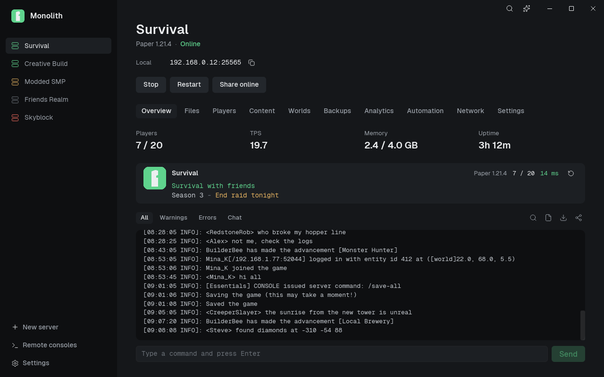
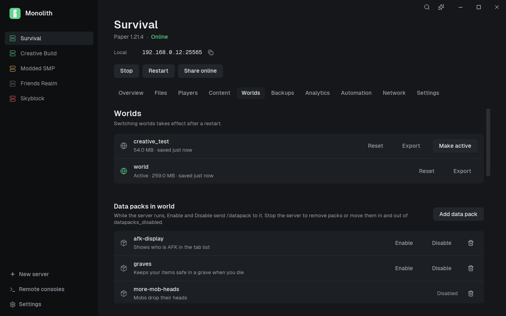
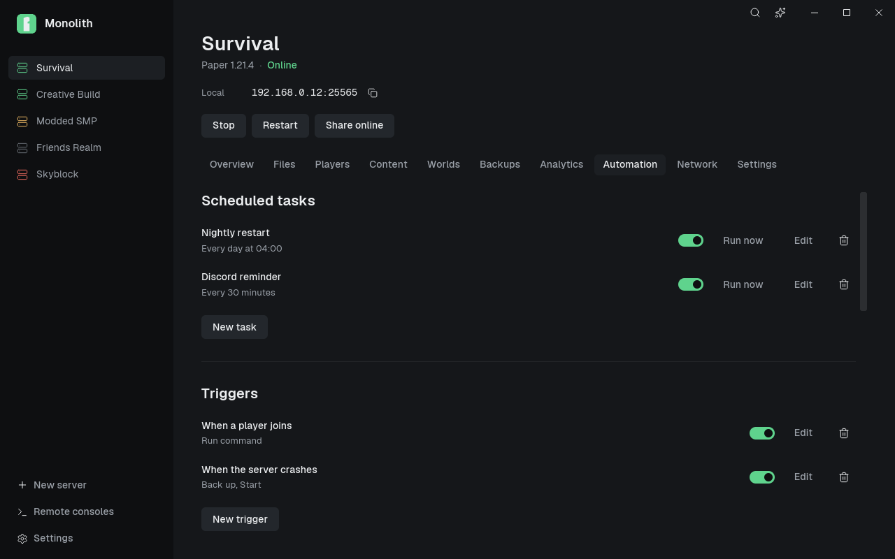
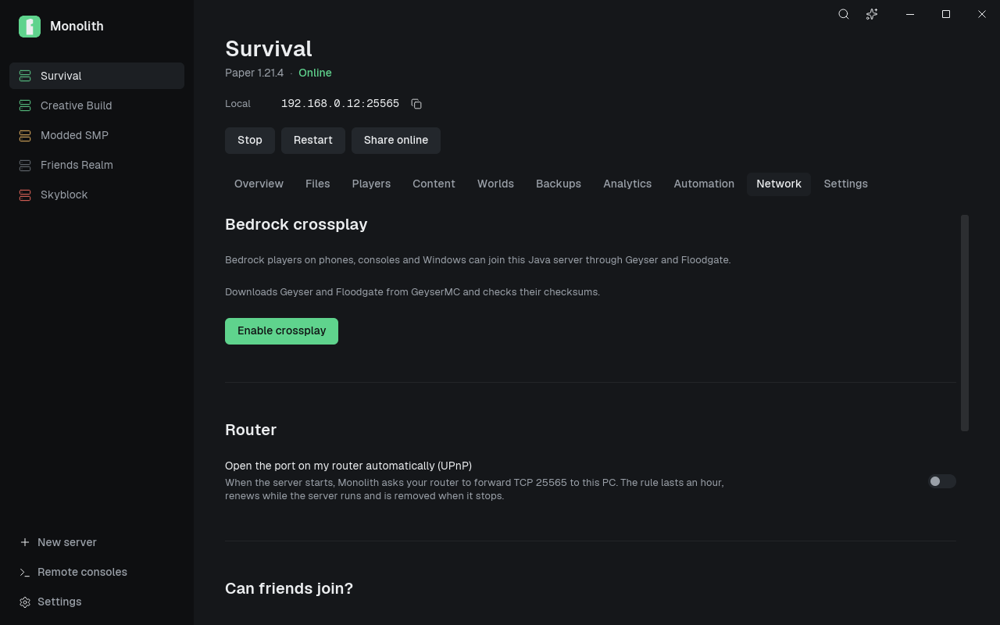

Monolith is a Minecraft server manager for Windows. Create, run, share and back up servers from one native app.



## Features

- **Create** servers on Paper, Purpur, Fabric, Quilt, Forge, NeoForge or Vanilla, from a Modrinth or CurseForge modpack, a saved template, or a copy of another server. Java is downloaded for you.
- **Console** with real Minecraft colours, `Ctrl+F` search, level and chat filters, Tab completion, old logs, crash reports with a likely cause, and mclo.gs uploads.
- **Players**: operators with levels, ban reasons and temporary bans, IP bans, and a whitelist you can fill in bulk.
- **Content** from Modrinth, Hangar, Spigot and optionally CurseForge, with dependency checks and disabling without deleting.
- **Worlds**: switch, create, import, export and reset worlds, manage data packs, pre-generate with Chunky and trim unvisited chunks.
- **Backups** on a schedule, on stop and before software changes, with retention, locking, excluded paths and a second copy folder.
- **Automation**: scheduled tasks, triggers on joins, chat and crashes, restarts that wait for an empty server, a watchdog, automatic server updates and sleep mode.
- **Network**: UPnP port forwarding, a reachability check, a firewall rule, Bedrock crossplay with Geyser, playit.gg or ngrok tunnels, and a Velocity proxy wizard.
- **Settings**: every `server.properties` key as a control with a MOTD preview, Bukkit, Spigot, Paper and Purpur config forms, live game rules, server icon and Java GC presets.
- **Also**: Discord alerts, RCON consoles, spark profiling, disk usage, analytics charts, a file editor with syntax checks, a `Ctrl+K` command palette, and an optional AI assistant that only acts after you confirm.

<p>
  
  
  
  
</p>

## Getting started

1. Download `Monolith-Setup-<version>.exe` from [Releases](https://github.com/waykehatescoding/monolith/releases) and run it.
2. Open Monolith, choose **Create your first server**, then press **Start** and accept the EULA.
3. Copy the join address and send it to your friends. For anyone outside your network, press **Share** or set up the **Network** tab.

## Requirements

- Windows 10 or 11, 64-bit.
- Enough free memory for your servers (Monolith suggests a sensible default).
- Java is downloaded automatically when a server needs it.

## Where your data lives

Servers, backups and settings are stored in `%APPDATA%\Monolith`. Uninstalling keeps this folder unless you choose to remove it.

## Building from source

You need Rust (stable) and, only for the analytics plugin, JDK 17 to 21.

```powershell
cargo build --release -p monolith            # the app
cd plugin; ./gradlew build; cd ..            # the analytics plugin
cargo run -p xtask -- assets                 # icons and brand images from assets/brand
```

To build the installer, point it at the app and plugin it should embed:

```powershell
$env:MONOLITH_PAYLOAD_EXE = "$PWD/target/release/monolith.exe"
$env:MONOLITH_PAYLOAD_PLUGIN = "$PWD/assets/plugins/MonolithAnalytics.jar"
cargo build --release -p monolith-setup
```

Run `monolith.exe --demo` to try the app with sample servers without touching your real data.

### Project layout

| Path | What it is |
| --- | --- |
| `crates/app` | The Monolith desktop app (iced) |
| `crates/core` | Server management: processes, downloads, backups, Modrinth, sharing |
| `crates/theme` | Design tokens, fonts, icons and widget styles |
| `crates/installer` | The Windows installer and uninstaller |
| `plugin` | The Monolith Analytics server plugin (Java) |
| `xtask` | Renders icons and brand images |

### Tests

```powershell
cargo test --workspace
```

## License

Monolith is released under the [GNU General Public License v3.0](LICENSE). Geist and Geist Mono are used under the SIL Open Font License, and Lucide icons under the ISC license.
